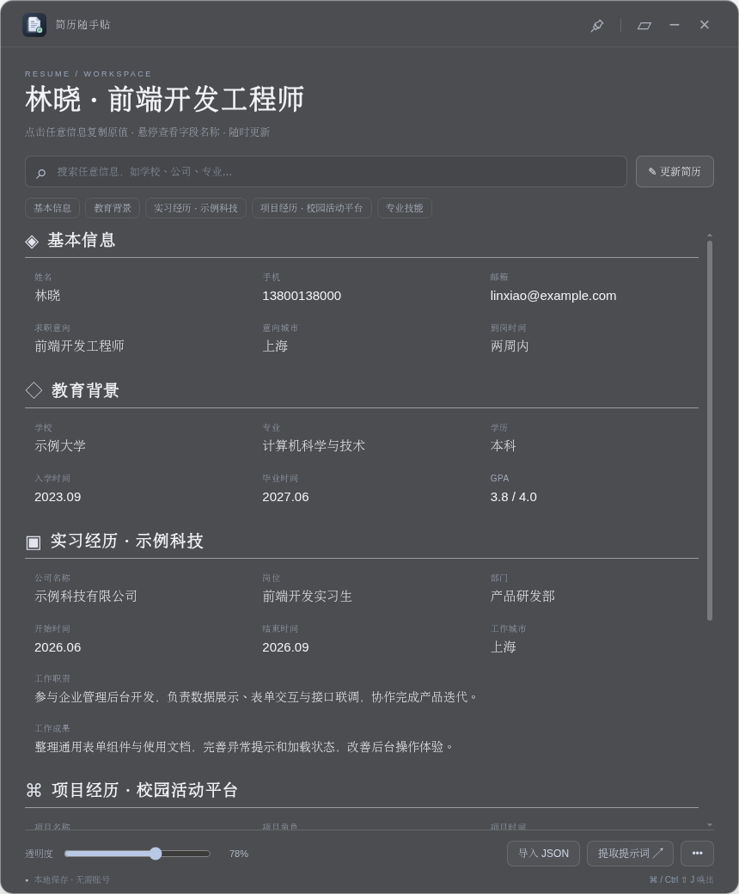

# 简历随手贴 · Resume Paste

把简历放在桌面一角，点击复制，减少投递时反复切换窗口。支持 **Windows、Linux、macOS**，不需要账号或模型 API Key。

[下载最新版](https://github.com/bulalalla/resume-paste/releases/latest) · [使用教程](docs/使用教程.md) · [测试简历](examples/test-resume.json)



## 能做什么

- 可拖动、置顶、调节透明度的桌面悬浮面板。
- 姓名、学校、公司、岗位等分别复制，主要工作与长文本整段复制。
- 默认左键复制文本、右键复制绑定的文件路径或 URL；操作可以自定义。
- 复制材料路径后，可粘贴到系统文件选择框中选取材料。
- 支持 JSON 导入、表单编辑、自定义分组、家庭成员及紧急联系人等补充信息。
- 默认 `Ctrl+Space` 折叠 / 展开，快捷键可修改；`Ctrl+Shift+J` 显示 / 隐藏（macOS 为 `Cmd+Shift+J`）。
- 数据保存在本机，可导出备份；应用不上传简历。

## 下载与试用

在 [Releases](https://github.com/bulalalla/resume-paste/releases/latest) 中按系统下载：

| 系统 | 文件 |
| --- | --- |
| Windows x64 | `windows-x64-setup.exe` 安装版，或 `windows-x64-portable.exe` 便携版 |
| Linux x64 | `.AppImage`，或 `.tar.gz` 解压运行 |
| macOS Apple 芯片 | 名称包含 `macos-arm64` 的 `.dmg` / `.zip` |
| macOS Intel | 名称包含 `macos-x64` 的 `.dmg` / `.zip` |

下载 `resume-paste-demo.zip` 并解压，点击应用「导入 JSON」，选择其中的 `test-resume.json` 即可体验。全部数据均为虚构。材料路径请在「编辑 / 补充」中选择本机文件重新绑定。

首次发布的 Windows / macOS 包未签名、未公证，系统可能要求确认来源。Linux 透明、置顶和全局快捷键可能受桌面环境影响。

## 导入自己的简历

复制应用内「提取提示词」，在自己使用的大模型中上传 PDF / Word 简历，再把模型返回的 JSON 导入应用。也可以不使用模型，直接点击「手动填写」。

完整步骤见 [使用教程](docs/使用教程.md)。

## 本地开发

需要 Node.js 22+：

```bash
git clone https://github.com/bulalalla/resume-paste.git
cd resume-paste
npm ci
npm start
```

```bash
npm test                         # 测试
npm run dist -- --win --x64      # 在 Windows 构建
npm run dist -- --linux --x64    # 在 Linux 构建
npm run dist -- --mac --arm64    # 在 macOS 构建 Apple 芯片版本
npm run dist -- --mac --x64      # 在 macOS 构建 Intel 版本
```

安装包输出到 `release/`。推荐在对应系统构建。推送 `v*` 标签会触发三平台构建，所有构建成功后自动发布 GitHub Release，并附带测试材料与 SHA-256 校验文件。

数据以明文保存在 Electron 用户数据目录，导出的 JSON 包含手动补充信息与绑定路径。更换电脑后需要重新绑定本机文件。项目不包含任何真实个人简历。
