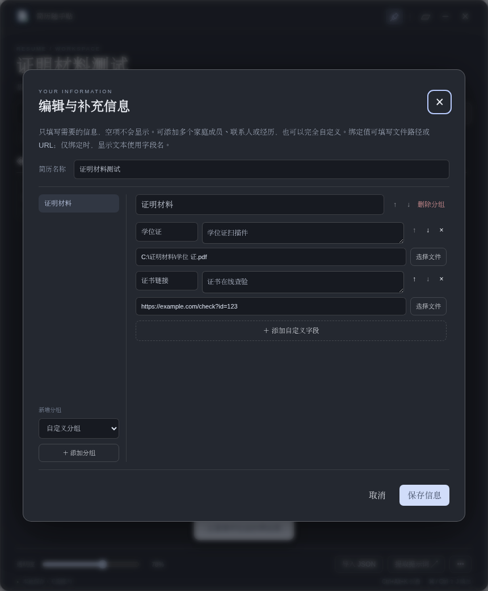

# 使用教程

## 1. 安装并打开

从 [最新版 Release](https://github.com/bulalalla/resume-paste/releases/latest) 下载与系统对应的文件。

- **Windows**：运行 `setup.exe` 安装；或直接运行 `portable.exe`。
- **macOS**：打开 DMG，将应用拖到 Applications。也可解压 ZIP 后放到 Applications。Apple 芯片选 arm64，Intel 选 x64。当前包未签名、未公证；如果系统拦截，请确认文件来源，再按系统「隐私与安全性」中的提示允许打开。
- **Linux**：给 AppImage 执行权限后运行，例如 `chmod +x resume-paste-*.AppImage`。缺少 FUSE 时可用 `./文件名.AppImage --appimage-extract-and-run`，或下载 tar.gz 解压并运行其中的 `resume-dock`。需在图形桌面中启动。

## 2. 用测试材料快速体验

1. 下载 Release 附件 `resume-paste-demo.zip` 并解压。
2. 点击「导入 JSON」，选择 `test-resume.json` 并保存。
3. 左键点击姓名，只复制姓名；点击「主要工作」可复制整段内容与换行。
4. 右键点击「证书查验链接」，复制绑定的示例 URL。
5. 点击「编辑 / 补充」，进入「证明材料」，在「学历证明」下点击「选择文件」，选择解压目录中的 `materials/学历证明-示例.pdf`，保存。
6. 右键点击学历证明，复制实际路径。打开网站的上传文件选择框，将路径粘贴到文件名输入框中确认，再由网站完成上传。

`test-resume.pdf` 和 `test-resume.md` 也可用于测试模型提取。所有人物、学校、公司、联系方式与经历都是虚构数据，证明 PDF 仅供功能演示。

## 3. 导入自己的 PDF / Word 简历

1. 在应用内点击「提取提示词」并复制。
2. 在你常用的大模型中上传简历，再发送提示词。
3. 把返回的 JSON 粘贴进应用「导入 JSON」，或选择 JSON 文件。
4. 保存后核对结果，尤其是日期、手机号与长文本。缺失内容可手动补充。

简历文件由你自行发给模型平台；本应用不会上传。没有模型也可以从欢迎页「手动填写」开始。

## 4. 编辑、添加与排序

点击「编辑 / 补充」：左侧选择分组，右侧修改字段名、文本和绑定值。可添加多个家庭成员、紧急联系人、教育与工作经历，也可建立自定义分组。使用箭头调整顺序；空项不会显示。取消退出不改变已保存数据。

多行工作内容作为完整文本复制。绑定值是独立的路径或 URL，不会和正文混在一起；没有绑定值时右键会提示，剪贴板保持原样。



## 5. 快捷键与鼠标操作

在「••• → 备份与设置」修改：

- 折叠 / 展开默认为 `Ctrl+Space`，可输入 `Ctrl+Alt+K` 等组合。
- 显示 / 隐藏为 `Ctrl+Shift+J`，macOS 为 `Cmd+Shift+J`。
- 复制文本默认 `LeftClick`（左键），复制绑定值默认 `RightClick`（右键）。
- 也支持 `MiddleClick`、`Ctrl+LeftClick`、`Shift+RightClick` 或 `Ctrl+Shift+P` 等组合。键盘复制需要先用鼠标或 Tab 聚焦目标字段；`None` 表示禁用。

两个复制动作不能设成同一个组合，也不能占用折叠 / 显示快捷键。如果全局快捷键注册失败，请换一个组合。输入法可能已占用 `Ctrl+Space`。修改设置后重启仍保留，可一键恢复默认。

## 6. 备份、重新导入与换机

在设置中导出 JSON。它包含全部手动补充信息和绑定值，妥善保存。

重新导入默认合并：同名分组内更新同名字段，其他信息保留；重复名称按顺序匹配。新 JSON 没有 `binding` 时保留旧绑定，明确写入空字符串时清除。取消勾选合并会整体替换。

换机后导入备份，并重新选择本机材料文件。复制 URL 只会得到链接文本，不会自动下载或上传；绑定路径不代表文件本身已备份。

## 7. 最小 JSON 示例

```json
{
  "version": 1,
  "name": "我的简历",
  "sections": [
    {
      "title": "基本信息",
      "fields": [{ "label": "姓名", "value": "示例同学" }]
    },
    {
      "title": "证明材料",
      "fields": [{ "label": "证书查验", "value": "查验链接", "binding": "https://example.com/certificate" }]
    }
  ]
}
```

每个字段的 `label`、`value` 为非空字符串，`binding` 为可选单行字符串。主要工作在同一个 `value` 中用 JSON 的 `\n` 保留换行。最多 50 个分组、500 个字段，JSON 不超过 2 MB。
